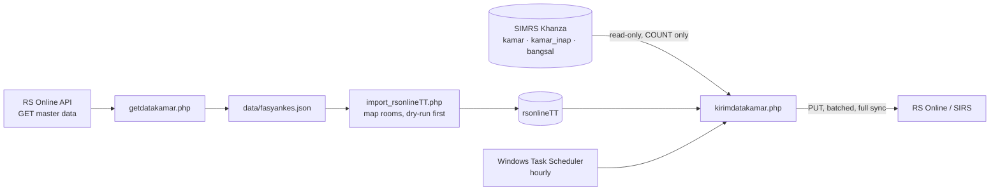

# RSOnlineTT-kemkes

[](https://github.com/ArkFunDev/RSOnlineTT-kemkes/actions/workflows/ci.yml)
[](https://www.php.net/)
[](https://github.com/ArkFunDev/RSOnlineTT-kemkes/actions/workflows/lint.yml)
[](https://github.com/ArkFunDev/RSOnlineTT-kemkes/actions/workflows/tests.yml)
[](LICENSE)
[](#known-limitations)

Automated bed-availability bridge between a hospital information system (**SIMRS Khanza**) and the Indonesian Ministry of Health's **RS Online / SIRS** platform (the data behind SIRANAP).

> 🇮🇩 *Ringkasan:* sinkronisasi otomatis ketersediaan tempat tidur dari database SIMRS Khanza ke RS Online Kemenkes. Hanya angka agregat (kapasitas & terpakai per ruang) yang dibaca dan dikirim, tanpa data identitas pasien. Panduan lengkap dalam bahasa Indonesia ada di bagian [Panduan Singkat](#panduan-singkat-bahasa-indonesia).

*Unofficial project. Not affiliated with or endorsed by the Indonesian Ministry of Health or the Khanza developers.*

## Why this exists

Hospitals in Indonesia must report bed availability to the national platform. Doing this by hand is slow and error-prone, and stale numbers mislead people looking for a hospital bed. This tool reads occupancy from the local hospital database and keeps the national platform current, hourly and unattended.

## How it works



1. **`getdatakamar.php`** pulls the hospital's bed master data from RS Online.
2. **`import_rsonlineTT.php`** maps Kemenkes room names (e.g. `MELATI B5-B6`) to local room codes, expanding ranges automatically and supporting manual overrides. Runs as a **dry run** unless you explicitly apply.
3. **`kirimdatakamar.php`** counts active inpatients per room, caps occupancy at the officially registered capacity, validates the result, and pushes every room in parallel batches. A full sync each run keeps timestamps fresh on the national side.
4. **`scripts/`** contains a Task Scheduler definition to run step 3 hourly.

## Privacy & security by design

- **No patient-identifiable data is read or transmitted.** The only query on inpatient data is `COUNT(*) GROUP BY kd_kamar`; payloads contain room names and numbers only.
- **No secrets in source control.** Credentials live in `.env` (git-ignored). Hospital-specific room filters and mappings live in git-ignored `config/*.php`, with `*.example.php` templates committed.
- **Web UIs are localhost-only by default** (`ALLOW_REMOTE=false`), POST actions are CSRF-protected, and all output is HTML-escaped.
- **Destructive/live actions are explicit:** live sending requires a POST/CLI `send`; DB import is a dry run until `apply`.
- **TLS verification is on by default.** It can be relaxed or pointed at a CA bundle via `.env` if needed.
- Prepared statements are used for all queries that take configuration input.
- `tools/debugvalidasi.php` is strictly read-only.

## Requirements

- PHP 7.4+ with `mysqli`, `curl`, `json`
- MySQL 5.7+ / MariaDB 10.2+ (uses `JSON_EXTRACT`)
- A SIMRS Khanza database (tables `kamar`, `kamar_inap`, `bangsal`)
- RS Online credentials issued by Kemenkes
- Windows + XAMPP for the bundled scheduler example (the PHP scripts are platform-independent; use cron on Linux)

## Setup

```bash
git clone https://github.com/ArkFunDev/RSOnlineTT-kemkes.git rsonline
cd rsonline

cp .env.example .env                                   # fill in RS_ID, RS_PASS, DB_*
cp config/filter.example.php config/filter.php         # which rooms to report
cp config/mapping_manual.example.php config/mapping_manual.php

mysql -u <user> -p <database> < docs/schema.sql        # creates rsonlineTT
```

Then:

```bash
php getdatakamar.php                 # 1. download master data -> data/fasyankes.json
php import_rsonlineTT.php            # 2. dry run: review unmatched rooms
php import_rsonlineTT.php apply      #    write mapping to rsonlineTT
php kirimdatakamar.php debug         # 3. simulate (no network write)
php kirimdatakamar.php send          #    live send
```

`kirimdatakamar.php send` exits with a non-zero code if any request failed, so schedulers and monitors can detect problems.

## Scheduling (Windows)

```bat
schtasks /create /tn AutoBridgeRSOnline /xml scripts\AutoBridgeRSOnline.xml
```

Adjust the path inside `scripts/AutoBridgeRSOnline.xml` (and `PHP_BIN` in `scripts/run_bridge.bat` if PHP is not in the default XAMPP location). On Linux, a cron entry such as `0 * * * * php /path/to/kirimdatakamar.php send` does the same job.

## Configuration

| File | Purpose | Committed |
|---|---|---|
| `.env` | Credentials and runtime options | No |
| `config/filter.php` | `kd_kamar` LIKE-patterns to include; Kemenkes IDs to block | No (template provided) |
| `config/mapping_manual.php` | Manual room mappings and ignored words | No (template provided) |

## Project layout

```
├── kirimdatakamar.php        # main sync: aggregate → validate → send (CLI + web)
├── getdatakamar.php          # download master data from RS Online
├── import_rsonlineTT.php     # map Kemenkes rooms to local rooms (dry-run by default)
├── index.php                 # manual single-record sender (testing/corrections)
├── config.php                # reads .env into constants
├── config/                   # filter & mapping templates
├── src/                      # bootstrap, helpers, API client
├── tools/                    # read-only diagnostics
├── scripts/                  # Windows Task Scheduler + launcher
├── docs/schema.sql           # rsonlineTT table
└── tests/run.php             # dependency-free unit tests
```

## Testing

```bash
php tests/run.php
```

CI (GitHub Actions) lints every PHP file and runs the tests on PHP 7.4, 8.1 and 8.3.

## Known limitations

- Written against the SIMRS Khanza schema; other HIS products need query changes.
- Room-name matching is heuristic. Always review the dry run before applying.
- COVID/suspect/DBD counters are currently sent as `0`.
- `docs/schema.sql` was reconstructed from the code; verify column types against your database.

## Panduan Singkat (Bahasa Indonesia)

1. Salin `.env.example` → `.env`, isi kredensial RS Online dan database.
2. Salin `config/filter.example.php` → `config/filter.php` dan `config/mapping_manual.example.php` → `config/mapping_manual.php`, sesuaikan dengan SK tempat tidur RS Anda.
3. Jalankan `docs/schema.sql` untuk membuat tabel `rsonlineTT`.
4. Urutan: `getdatakamar.php` → `import_rsonlineTT.php` (cek dry-run, lalu `apply`) → `kirimdatakamar.php debug` → `kirimdatakamar.php send`.
5. Jadwalkan otomatis tiap jam dengan Task Scheduler (`scripts/AutoBridgeRSOnline.xml`).

**Penting:** jangan pernah meng-commit `.env`, `config/filter.php`, `config/mapping_manual.php`, folder `data/` dan `log/`. Semuanya sudah ada di `.gitignore`.

## License

[MIT](LICENSE)
